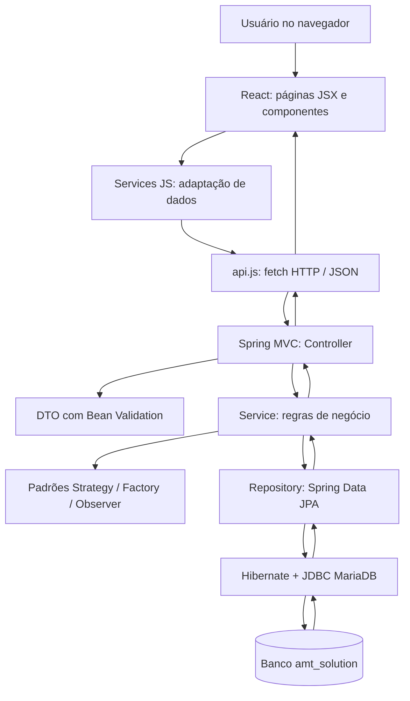

# 03 — Arquitetura: do navegador ao banco e de volta

## 1. Visão em camadas



O desenho representa responsabilidades conceituais: no código real, o Controller recebe o DTO validado como argumento e então chama o Service. Os padrões estão **dentro da camada de negócio**, utilizados conforme o caso — não são uma camada que toda requisição obrigatoriamente atravessa.

## 2. Ponto de entrada do React

1. `Frontend/index.html` possui o elemento raiz.
2. `Frontend/src/main.jsx` faz `ReactDOM.createRoot(document.getElementById("root")).render(<React.StrictMode><App /></React.StrictMode>)`.
3. `Frontend/src/App.jsx` configura `BrowserRouter`, o componente `ToastContainer` e as rotas.
4. `AppShell.jsx` contém `Sidebar` e um `Outlet` onde a página da rota ativa é inserida.
5. O usuário navega e o React renderiza a página JSX correspondente.

`<React.StrictMode>` ajuda a identificar padrões problemáticos no desenvolvimento; alguns efeitos podem rodar mais de uma vez em ambiente de desenvolvimento, sem que isso necessariamente represente duas operações reais de escrita.

## 3. Ponto de entrada do backend

`Backend/src/main/java/com/amtsolution/AmtSolutionApplication.java` contém a classe com `@SpringBootApplication` e o método `main` que inicializa o Spring. O Spring identifica `@RestController`, `@Service`, `@Component`, `@Configuration` e interfaces Repository, cria objetos administrados pelo contêiner (*beans*) e injeta dependências pelos construtores.

A aplicação expõe URLs como `/api/produtos` e `/api/contas-pagar`; o prefixo e o método HTTP identificam a operação do Controller.

## 4. Fluxo completo de leitura (GET)

```text
Pessoa abre /fornecedores
  → React monta Fornecedores.jsx
  → useEffect chama carregar()
  → fornecedoresService.listar()
  → request('/fornecedores')
  → fetch GET http://localhost:8080/api/fornecedores
  → FornecedorController.listar()
  → FornecedorService.listar()
  → FornecedorRepository.findAll()
  → Hibernate/JDBC lê fornecedores
  → lista JSON retorna ao navegador
  → map() transforma documento em cnpj e booleano ativo em status
  → setDados(...) atualiza o estado e a tabela renderiza
```

Por que `GET`? Porque a operação consulta um recurso, em vez de solicitar a criação/alteração dele.

## 5. Fluxo completo de criação (POST)

```text
Pessoa salva uma nova conta a pagar
  → validações básicas no formulário
  → contasPagarService.criar(form)
  → converte datas e valores: payload(...)
  → api.request POST /contas-pagar com JSON
  → ContaPagarController.criar(@Valid @RequestBody ContaPagarRequest)
  → Bean Validation confere os campos do record
  → ContaPagarService.criar(request)
  → CriadorContaPagar.criar().entidade() (Factory Method)
  → preencher(...) transfere dados e resolve fornecedor
  → repository.save(...)
  → INSERT na tabela contas_pagar
  → resposta HTTP 201 Created com Location e corpo JSON
  → formulário fecha, a lista é recarregada
```

## 6. Fluxo completo de erro

Exemplo: cadastrar fornecedor com documento duplicado.

1. `FornecedorService.criar` consulta `existsByDocumento`.
2. Quando há duplicação, lança `ConflictException("Documento já cadastrado.")`.
3. `ApiExceptionHandler` captura a exceção e produz **HTTP 409 Conflict** com campo `erro`.
4. `api.js` detecta `!response.ok`, lê JSON e lança `new Error(body.erro ...)`.
5. `Fornecedores.jsx` captura a exceção (`catch`) e exibe um `toast` de erro.

Isso explica por que simplesmente mostrar uma mensagem no React **não basta** como regra de integridade: o backend e o banco também devem protegê-la.

## 7. Diferença entre arquitetura em camadas e MVC

MVC separa Model, View e Controller; o projeto usa uma divisão web moderna que combina apresentação React, Controller HTTP, Service de negócio e Repository de persistência. Pode-se dizer que há **separação por responsabilidades/camadas inspirada em MVC**, mas não que o React seja uma View JSP controlada diretamente pelo Spring MVC: são aplicações independentes que comunicam via API REST.

## 8. Inversão de controle, dependências e acoplamento

Em vez de cada classe criar todas as suas dependências com `new`, o Spring as fornece no construtor. Exemplo: `ProdutoService` recebe `ProdutoRepository`, `FornecedorRepository`, `AvisoRepository` e `SujeitoProduto`. Isso facilita trocar implementações, compreender dependências e manter responsabilidades separadas.

O **acoplamento** seria maior se o Controller implementasse JDBC, cálculo de juros e geração de avisos em um único método. Separar camadas concentra decisões em locais distintos e evita replicação.

## 9. Transações e consistência

A anotação `@Transactional` nos Services delimita operações com participação do banco. Se uma operação de persistência falha com uma exceção que provoca rollback, o Spring pode desfazer mudanças da transação. `@Transactional(readOnly = true)` sinaliza operações de leitura. Não confunda **transação de banco** com uma requisição HTTP nem com o estado de um componente React.

## 10. Ciclo de vida de um dado

- **Formulário**: o usuário digita uma data no formato brasileiro.
- **Service JS**: `toApiDate` converte `dd/mm/aaaa` para `aaaa-mm-dd`.
- **JSON**: transporta valores e nomes de campos.
- **DTO**: tipa e valida o JSON recebido.
- **Service Java**: verifica regra e associação, eventualmente aciona um padrão.
- **Entity**: armazena estrutura Java mapeada à tabela.
- **Repository/ORM**: salva ou recupera.
- **Response**: retorna status/corpo; frontend converte e exibe.

## 11. Perguntas do professor

- “Por que duas aplicações em vez de React e SQL diretamente?” — Separação de responsabilidades, segurança e validação no servidor.
- “Onde deve ficar a regra de negócio?” — Principalmente no Service Java, com proteção no banco onde aplicável.
- “Quem transforma a entidade em JSON?” — A infraestrutura web do Spring/Jackson no caminho da resposta.
- “Onde o padrão Factory interfere na requisição?” — No `ContaPagarService.criar` antes de `repository.save`.
- “O que acontece depois de um erro 400?” — A requisição é recusada, e o frontend recebe a mensagem sem declarar salvamento.
