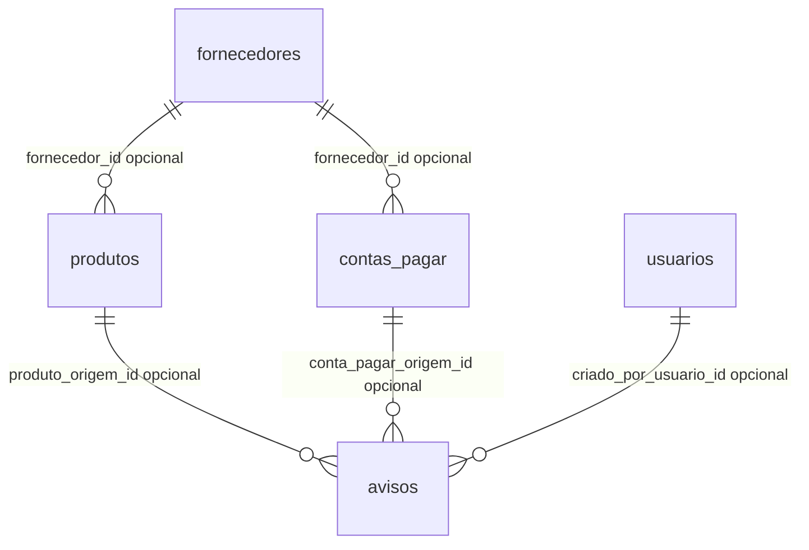

# 07 — Banco de dados MariaDB, modelagem relacional, SQL e JPA

## 1. Por que banco relacional?

O AMT Solution mantém cadastros que precisam sobreviver ao recarregamento do navegador e ao encerramento da aplicação. O MariaDB é um SGBD relacional: armazena tabelas, linhas e colunas; permite consultas SQL e reforça a consistência por chaves, tipos, restrições e transações.

Os scripts reais estão em `Frontend/database/01_schema.sql` e `02_seed.sql`. O primeiro usa `CREATE DATABASE IF NOT EXISTS amt_solution` e `CREATE TABLE IF NOT EXISTS`, com codificação `utf8mb4`. O segundo oferece **dados de demonstração**; não é necessário reexecutá-lo repetidamente em um banco já utilizado pelo grupo.

## 2. Seis tabelas efetivas

| Tabela | Entidade JPA | O que guarda | Alguns campos importantes |
|---|---|---|---|
| `fornecedores` | `Fornecedor` | Empresas/contatos fornecedores | `id`, `nome`, `documento`, `contato`, `ativo` |
| `produtos` | `Produto` | Produtos vendáveis e insumos | `tipo`, `codigo`, `quantidade_estoque`, `quantidade_minima`, `fornecedor_id` |
| `contas_pagar` | `ContaPagar` | Obrigações/despesas | `valor_original`, `vencimento`, `situacao`, `fornecedor_id` |
| `contas_receber` | `ContaReceber` | Valores a receber | `cliente`, `valor_original`, `vencimento`, `situacao` |
| `usuarios` | `Usuario` | Cadastros administrativos | `email`, `senha_hash`, `perfil`, `ativo` |
| `avisos` | `Aviso` | Comunicados manuais e alertas automáticos | `tipo`, `prioridade`, `situacao`, `chave_evento`, IDs de origem |

Produtos e insumos compartilham a tabela `produtos` e diferem pelo ENUM `tipo` (`PRODUTO` ou `INSUMO`). O frontend utiliza abas e formulários próprios, mas ambos usam o mesmo backend.

## 3. Diagrama das relações efetivas (simplificado)



O diagrama resume relacionamentos **opcionais no lado que contém a FK**: nem todo produto possui fornecedor e nem todo aviso tem uma origem de produto, conta ou usuário. A leitura “um fornecedor pode ter vários produtos” não significa que a coluna seja obrigatória.

## 4. PK, FK, UNIQUE, índice e NULL

- **PK (`PRIMARY KEY`)** identifica uma linha sem duplicações; a coluna `id` tem auto-incremento.
- **FK (`FOREIGN KEY`)** referencia uma PK de outra tabela; por exemplo `produtos.fornecedor_id` aponta para `fornecedores.id`.
- **UNIQUE** impede duplicação de valores em colunas como `documento`, `codigo`, `email` e `chave_evento` quando não nulos.
- **Índice** acelera certos filtros/relacionamentos; há índices por fornecedor, status e vencimento.
- **`NOT NULL`** obriga preenchimento; campo nullable admite ausência (`NULL`).

Há verificações prévias no Service para algumas unicidades, **e** o banco possui restrições: as duas camadas se complementam.

## 5. Relacionamentos e comportamentos de DELETE

O esquema explicita:

- `produtos.fornecedor_id` → `fornecedores.id`: `ON DELETE SET NULL`.
- `contas_pagar.fornecedor_id` → `fornecedores.id`: `ON DELETE SET NULL`.
- `avisos.produto_origem_id` → `produtos.id`: `ON DELETE RESTRICT`.
- `avisos.conta_pagar_origem_id` → `contas_pagar.id`: `ON DELETE RESTRICT`.
- `avisos.criado_por_usuario_id` → `usuarios.id`: `ON DELETE SET NULL`.

**Consequência:** excluir fornecedor não obriga apagar seus produtos/contas: as referências no banco podem ficar nulas. Excluir produto/conta a pagar com avisos dependentes deve ser bloqueado; os Services `ProdutoService.excluir` e `ContaPagarService.excluir` verificam avisos e lançam `ConflictException`. A remoção de um usuário referenciado por aviso permite preservar o aviso sem seu criador associado. Não há cascata de exclusão indiscriminada.

## 6. Valores monetários e datas

O esquema utiliza `DECIMAL(10,2)` para valores de moeda e `DECIMAL(12,3)` para quantidades (ex.: unidades fracionárias/quilogramas). Os Models usam `BigDecimal` e `LocalDate`. Exemplos:

- R$ 420,00 → `BigDecimal("420.00")` conceitualmente.
- Estoque de 1,250 kg → `DECIMAL(12,3)`.
- Vencimento 2026-10-20 → `LocalDate` e SQL `DATE`.

**Por que não `float`/`double` para dinheiro?** A representação binária em ponto flutuante introduz imprecisões em certos valores decimais. `BigDecimal` armazena representação decimal apropriada com arredondamento explícito.

## 7. JPA e Hibernate na prática

Exemplo do Model `Produto.java`:

```java
@Entity
@Table(name = "produtos")
public class Produto {
    @Id
    @GeneratedValue(strategy = GenerationType.IDENTITY)
    private Long id;

    @ManyToOne(fetch = FetchType.EAGER)
    @JoinColumn(name = "fornecedor_id")
    private Fornecedor fornecedor;
}
```

`@Entity` mapeia classe Java a registro; `@Table` define tabela; `@Id` marca chave; `@GeneratedValue(IDENTITY)` usa ID gerado pelo banco; `@ManyToOne` expressa vários produtos para um fornecedor; `@JoinColumn` define FK. O trecho é parcial: a classe real tem outras propriedades e métodos.

## 8. O que `repository.save()` realiza?

O `JpaRepository` entrega a entidade ao mecanismo JPA. Conforme ela é nova ou já existente e o contexto de persistência, Hibernate organiza uma operação equivalente à inserção/atualização SQL. Não é correto afirmar que **cada** `save` dispara sempre e imediatamente um `INSERT`: comportamento e sincronização dependem do estado da entidade e do flush/transaction.

No DELETE, Services chamam `repository.delete(...)` seguido de `repository.flush()` para forçar sincronização e tornar falhas de integridade observáveis durante a operação.

## 9. `ddl-auto=validate`

O arquivo `Backend/src/main/resources/application.properties` especifica `spring.jpa.hibernate.ddl-auto=validate`. O Hibernate verifica a compatibilidade do mapeamento com a estrutura existente; **não cria nem altera tabelas automaticamente**. Por isso o script SQL deve ter sido aplicado antes da execução da API.

## 10. Por que timestamps são `insertable = false, updatable = false`?

Campos `criado_em` e `atualizado_em` são mantidos no banco por `DEFAULT CURRENT_TIMESTAMP` e `ON UPDATE CURRENT_TIMESTAMP`. Nos Models, colunas correspondentes são marcadas para não serem incluídas pelo ORM nas gravações. Isso delega o controle desses metadados ao SGBD.

## 11. Exemplos de SQL para estudar (apenas consulta)

```sql
USE amt_solution;
SHOW TABLES;
DESCRIBE produtos;
SELECT id, tipo, codigo, nome, quantidade_estoque, quantidade_minima FROM produtos;
SELECT id, descricao, vencimento, valor_original, situacao FROM contas_pagar;
SELECT id, tipo, titulo, chave_evento, produto_origem_id, conta_pagar_origem_id FROM avisos;
```

Essas consultas ajudam a confirmar correspondência entre tela, entidade e tabela; não modificam dados. Para a prova, a demonstração dos padrões pode ser feita inteiramente pelo navegador conforme a preferência da equipe.

## 12. Armadilhas de interpretação

- `FORNECEDOR` não é coluna de texto arbitrária dentro de `Produto`: é uma associação JPA com FK.
- `@ManyToOne` não significa que toda tabela tem associação bidirecional; nem todos os Models têm listas inversas.
- `@Column(unique=true)` não substitui todas as validações; o Service também trata duplicações.
- O banco não “guarda o resultado de cada simulação” de Strategy: a operação usa o valor original e devolve cálculo.
- Arquivar `Aviso` altera `situacao` para `ARQUIVADO`, mas **não é** exclusão física.

## 13. Perguntas para responder

1. Por que há seis tabelas e somente uma para Produtos/Insumos?
2. O que significam chave primária, estrangeira e índice?
3. O que ocorre ao tentar excluir um produto referenciado em aviso?
4. Qual a função do `JpaRepository`?
5. Para que serve `@JoinColumn`?
6. Por que `BigDecimal` é importante no financeiro?
7. Por que é necessário executar script SQL se o Spring Boot já tem JPA?
8. Como a tabela evita avisos duplicados por `chave_evento`?
