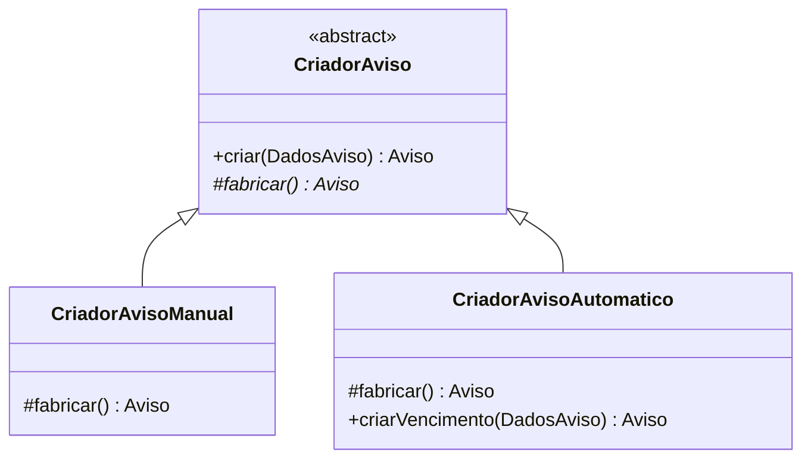

# 10 — Factory Method: teoria, criadores, produtos e uso real

## 1. Conceito

**Factory Method** é um padrão criacional no qual uma classe criadora declara um método de fábrica e permite que subclasses decidam **qual objeto concreto** produzir. O código consumidor pede a criação por meio do criador apropriado em vez de conhecer toda a lógica concreta de construção.

**Problema resolvido:** separar a escolha do tipo de objeto do restante do fluxo de negócio, sem espalhar por Serviços verificações e instanciações especializadas.

**Diferença de uma função utilitária:** uma função estática que recebe um tipo e faz `switch` para `new` é frequentemente chamada *Simple Factory*. No Factory Method há um criador abstrato/base e **subclasses especializadas sobrescrevem o método que cria o produto**.

## 2. Exemplo 1 — Avisos manuais e automáticos

Arquivos em `Backend/src/main/java/com/amtsolution/patterns/factory/`:

| Classe | Papel |
|---|---|
| `CriadorAviso` | criador abstrato com operação pública `criar(DadosAviso)` e fábrica abstrata `fabricar()` |
| `CriadorAvisoManual` | criador concreto: fabrica `Aviso` com tipo `MANUAL` |
| `CriadorAvisoAutomatico` | criador concreto: fabrica `Aviso` de estoque baixo e ajusta tipo para vencimento quando necessário |
| `DadosAviso` | record contendo título, corpo, prioridade, público, datas, situação e associações potenciais |
| `Aviso` | entidade/produto persistido |
| `AvisoService` | cliente que utiliza as fábricas e persiste o resultado |

## 3. Como o criador abstrato trabalha

Trecho do `CriadorAviso.java`:

```java
public abstract class CriadorAviso {
    public Aviso criar(DadosAviso dados) {
        Aviso aviso = fabricar();
        aviso.setTitulo(dados.titulo());
        aviso.setCorpo(dados.corpo());
        // Preenche outras informações comuns.
        return aviso;
    }
    protected abstract Aviso fabricar();
}
```

**Ponto-chave:** o método **`criar`** controla o procedimento comum e chama **`fabricar()`** (Factory Method propriamente dito); cada subclasse fornece a decisão de construção. O método `fabricar()` é `protected` para acesso dentro da hierarquia.

`CriadorAvisoManual.fabricar()` retorna `new Aviso()` com `tipo = "MANUAL"`. `CriadorAvisoAutomatico.fabricar()` retorna `new Aviso()` com `tipo = "ESTOQUE_BAIXO"`, e seu método `criarVencimento()` reutiliza a criação e substitui o tipo para `VENCIMENTO_PROXIMO`.

**Nuance técnica:** as fábricas de avisos produzem **a mesma classe concreta `Aviso` configurada com tipos diferentes**, não três subclasses JPA de Aviso. A variação no tipo é feita pela configuração do atributo `tipo`. Na autoria, descreva isso com precisão.

## 4. Uso no `AvisoService`

- `AvisoService.criar(AvisoRequest)` chama `manual.criar(new DadosAviso(...))`, completa o mapeamento e persiste. Esse caminho é acionado pelo formulário **Novo Aviso**.
- `AvisoService.criarAvisoEstoque` verifica chave do evento, chama `automatico.criar(...)`, associa produto de origem e salva.
- `AvisoService.criarAvisoVencimento` verifica chave do evento, chama `automatico.criarVencimento(...)`, associa conta de origem e salva.

O Factory Method **não salva por si só no banco**. Ele fabrica/configura a entidade; o Service persiste pelo Repository.

## 5. Exemplo 2 — Lançamentos financeiros

| Classe | Papel |
|---|---|
| `CriadorLancamentoFinanceiro` | criador abstrato: `criar()` delega a `fabricar()` |
| `CriadorContaPagar` | concreto: produz `ContaPagar` |
| `CriadorContaReceber` | concreto: produz `ContaReceber` |
| `LancamentoFinanceiro` | interface de produto que expõe `Object entidade()` |
| `ContaPagar` e `ContaReceber` | entidades concretas persistidas |
| `ContaPagarService`, `ContaReceberService` | clientes da fábrica |

Trecho fiel ao desenho da implementação:

```java
public abstract class CriadorLancamentoFinanceiro {
    public LancamentoFinanceiro criar() {
        return fabricar();
    }
    protected abstract LancamentoFinanceiro fabricar();
}
```

A implementação `CriadorContaPagar.fabricar` instancia `ContaPagar` e devolve `() -> c`, uma **expressão lambda** que implementa `LancamentoFinanceiro.entidade()`. `CriadorContaReceber` realiza o equivalente com `ContaReceber`.

## 6. Por que existe a interface `LancamentoFinanceiro`?

Ela representa o produto abstrato da fábrica. Neste código, seu único método `Object entidade()` permite recuperar a entidade embrulhada. Os Services fazem **cast explícito**:

```java
ContaPagar c = (ContaPagar) criador.criar().entidade();
```

É uma implementação simples para o exercício acadêmico. **Limitação honesta:** devolver `Object` e precisar de cast reduz segurança estática de tipos comparado a uma solução genérica mais sofisticada. Essa observação é uma oportunidade de demonstrar compreensão, não motivo para refatorar o projeto na véspera da entrega.

## 7. Como demonstrar o Factory Method no navegador

### Avisos

1. Abrir **Avisos** e cadastrar um comunicado manual.
2. Ver que aparece na listagem após a persistência.
3. Abrir `AvisoService.criar`, apontar `manual.criar(...)`.
4. Abrir `CriadorAviso.criar` e `CriadorAvisoManual.fabricar` e identificar a sobrescrita.
5. Demonstrar um aviso automático gerado por Observer e abrir `CriadorAvisoAutomatico`.

### Lançamentos

1. Abrir **Contas a Pagar**, cadastrar uma obrigação e confirmar a listagem.
2. Abrir **Contas a Receber**, cadastrar um recebível.
3. Abrir `ContaPagarService.criar` e `ContaReceberService.criar`.
4. Mostrar `CriadorLancamentoFinanceiro`, seus dois concretos e a interface `LancamentoFinanceiro`.

Sem botões artificiais “executar Factory”: o padrão está no **fluxo normal de cadastro**.

## 8. Diagrama conceitual (não um UML exaustivo)



`*` indica método abstrato apenas no diagrama didático; consulte a assinatura Java real no código.

## 9. Diferenças de Strategy, Factory e Observer

- **Factory Method** pergunta: *qual objeto devemos criar?*
- **Strategy** pergunta: *qual algoritmo devemos executar?*
- **Observer** pergunta: *quem precisa ser notificado quando ocorre um evento?*

No fluxo de alerta automático, Observer descobre que deve reagir e chama `AvisoService`, que utiliza Factory Method para produzir o aviso. Isso é **cooperação entre padrões**, não dois nomes para a mesma coisa.

## 10. Perguntas difíceis

1. **Qual é o Factory Method de avisos?** `CriadorAviso.fabricar`, implementado nos criadores concretos.
2. **Qual é o método de fábrica financeiro?** `CriadorLancamentoFinanceiro.fabricar`, sobrescrito pelas duas classes especializadas.
3. **Quem decide criar aviso manual?** O fluxo de `AvisoService.criar`, que usa `CriadorAvisoManual`.
4. **A fábrica faz INSERT?** Não; o Service salva depois de receber a entidade.
5. **O produto é sempre uma subclasse?** Não neste código: avisos são uma mesma classe `Aviso` configurada; lançamentos são entidades distintas.
6. **Por que é Factory Method e não Abstract Factory?** O exemplo usa método de criação especializado por subclasses, não famílias complexas de produtos relacionados por várias fábricas.
7. **Que papel possui `DadosAviso`?** Record de transporte de parâmetros comuns de criação.
8. **O que faz a lambda `() -> c`?** Implementa funcionalmente `LancamentoFinanceiro.entidade` retornando a entidade recém-criada.
9. **Qual limitação de `Object entidade()`?** Exige cast e não informa tipo concreto em compilação ao chamador.
10. **Como comprovar o padrão no código?** Mostrar pai abstrato → implementação concreta de `fabricar` → chamada do Service → persistência.

## 11. Resposta oral resumida

> “Factory Method separa a criação de objetos das demais regras. No AMT Solution, temos um criador abstrato de avisos e criadores concretos para avisos manuais e automáticos; o AvisoService utiliza o criador apropriado e persiste o objeto. Temos também um criador financeiro abstrato, com implementações para contas a pagar e receber. O comportamento é mostrado ao cadastrar os registros na interface; no código, apontamos o método `fabricar()` sobrescrito pelas subclasses.”
