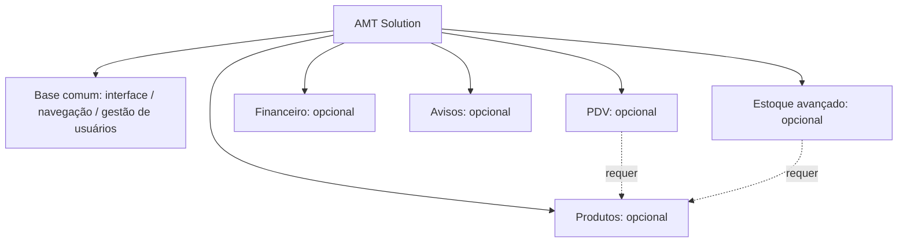

# 13 — Variabilidade, Linha de Produto de Software (LPS) e Feature Model

> **Importante quanto à fonte:** os dois ZIPs enviados **não incluíram** o documento `VARIABILIDADE_LPS.md`. Este capítulo é uma **aula teórica aplicada ao planejamento discutido anteriormente**, e não uma conferência literal do texto entregue ao professor. Se existir documento final separado, cruzar com ele antes da prova.

## 1. O que é variabilidade em software?

Variabilidade é a capacidade **planejada** de um sistema ou família de produtos oferecer características diferentes conforme o contexto, mantendo uma base comum. Nem toda organização precisa usar os mesmos módulos.

Exemplo: uma loja de doces pode precisar de cadastro de produtos e PDV; um prestador de serviços pode focar contas, usuários e avisos, sem venda por catálogo de produtos.

## 2. O que é Linha de Produto de Software?

**LPS** (*Software Product Line*) é uma abordagem de engenharia para desenvolver uma família de produtos relacionados a partir de **ativos comuns** (arquitetura, componentes, infraestrutura) e **pontos de variação** (features selecionáveis). Em vez de reconstruir uma aplicação do zero para cada cliente, a empresa planeja combinações válidas das funcionalidades.

**Reuso na LPS:** partes estáveis podem ser reaproveitadas; variações são escolhidas conforme regras. Não se confunde com apenas copiar e colar o código para cada cliente.

## 3. Vocabulário fundamental

- **Feature/característica:** capacidade visível ou arquitetural que pode entrar em uma versão do sistema.
- **Obrigatória (mandatory):** aparece em toda configuração válida da família.
- **Opcional (optional):** pode ser selecionada ou omitida.
- **Alternativa (XOR):** exatamente uma entre opções exclusivas.
- **Grupo OR:** uma ou mais opções podem ser escolhidas.
- **Requires (depende de):** se A é escolhido, B também deve ser escolhido.
- **Excludes (exclui):** A e B não podem coexistir numa mesma configuração.
- **Configuração válida:** conjunto de características que cumpre as regras.
- **Feature Model:** representação das features, grupos e dependências.

## 4. Exemplo didático de Feature Model para AMT Solution

**Aviso:** o modelo acima é **proposta didática**, não o Feature Model literal da entrega. Uma versão final pode escolher outro conjunto de características obrigatórias/opcionais, desde que justifique as dependências.

## 5. Duas configurações válidas — exemplos

### Configuração A: loja de doces

Base comum + Produtos/Insumos + PDV + Estoque + Financeiro + Avisos. O PDV pode consumir a estrutura de produtos; o financeiro acompanha obrigações e recebíveis.

### Configuração B: prestador de serviços

Base comum + Financeiro + Avisos, com Produtos e PDV desativados. O prestador precisa gerenciar serviços e recebíveis sem obrigatoriamente vender itens em um PDV de produtos.

**Ambas são possibilidades de planejamento**, não variantes efetivamente distribuídas por um configurador nesta versão acadêmica.

## 6. Configuração inválida

**PDV ligado + Produtos desligado**, quando a regra do produto define `PDV → requer Produtos`. Isso viola a dependência, pois o PDV pressupõe um catálogo para selecionar itens de venda. Para corrigir, ativar Produtos ou desativar PDV.

A lógica de validação de configuração é diferente de um formulário que valida e-mail: ela protege a **coerência da combinação de features** escolhidas para uma versão do produto.

## 7. Planejamento versus implementação

O requisito conhecido é **planejar um exemplo de variabilidade**, não criar todo o mecanismo de feature flags. O documento de planejamento pode mostrar features, relações, configurações e estratégia futura de implementação. Não afirmar que o AMT Solution já monta versões dinamicamente conforme o tipo de cliente.

A página `PermissoesModulos.jsx` **não comprova por si só uma LPS implementada**: ela usa estado local/mock para visualização; permissões de acesso de pessoas e composição de um produto por features são assuntos diferentes.

## 8. Como isso poderia ser implementado futuramente? (proposta, não código existente)

Um configurador poderia armazenar módulos habilitados por organização, verificar dependências antes de salvar a configuração, ocultar rotas no frontend **e reforçar as restrições de acesso no backend**. Também seria possível gerar variantes distintas em build/deploy. A escolha dependeria de requisitos de cada família de clientes.

Lembrar: ocultar item do menu sozinho não desliga endpoint nem representa isolamento de permissões no servidor.

## 9. Como defender a decisão acadêmica

> “Para atender ao requisito de variabilidade, modelamos possíveis versões do AMT Solution baseadas em recursos comuns e módulos opcionais. Uma loja de doces poderia usar PDV e Produtos, enquanto um prestador de serviços pode priorizar Financeiro e Avisos. O Feature Model expressa a dependência de PDV em Produtos; assim, não seria válida uma configuração com PDV ativo e Produtos desativado. Esse é um planejamento conceitual, não uma feature flag implementada no protótipo atual.”

## 10. Perguntas de autoria

1. Por que variabilidade é uma forma de reuso estratégico?
2. Qual diferença entre módulo obrigatório e opcional?
3. O que é uma regra `requires`?
4. O que faz uma configuração inválida?
5. Qual a diferença entre a página Permissões e um configurador LPS?
6. A LPS exige obrigatoriamente microserviços? Não; é abordagem de família de produtos, independente de arquitetura específica.
7. Podemos afirmar que o sistema já se transforma em versões automaticamente? Não, somente com implementação real da variabilidade.
8. Como validaria uma configuração de features antes de disponibilizá-la?
