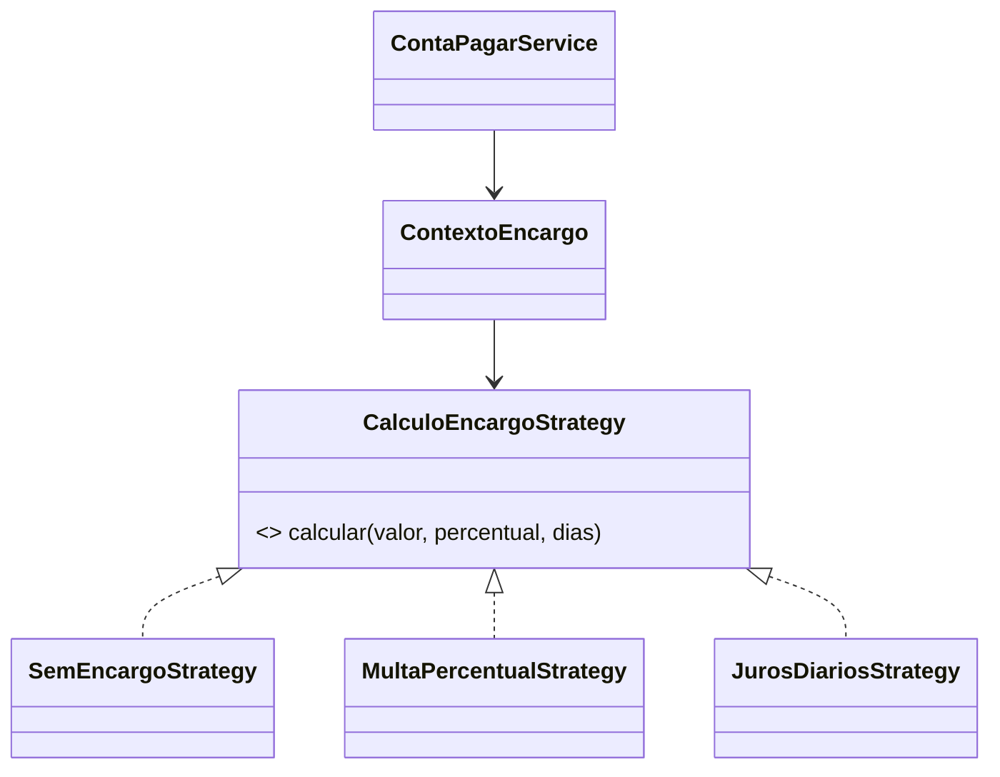
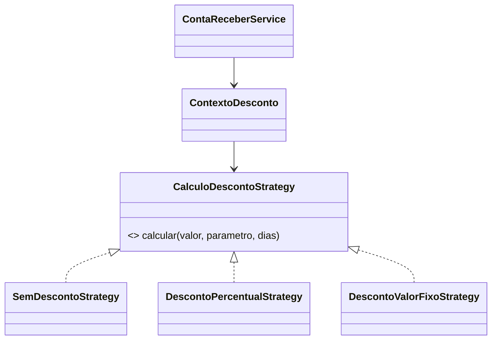
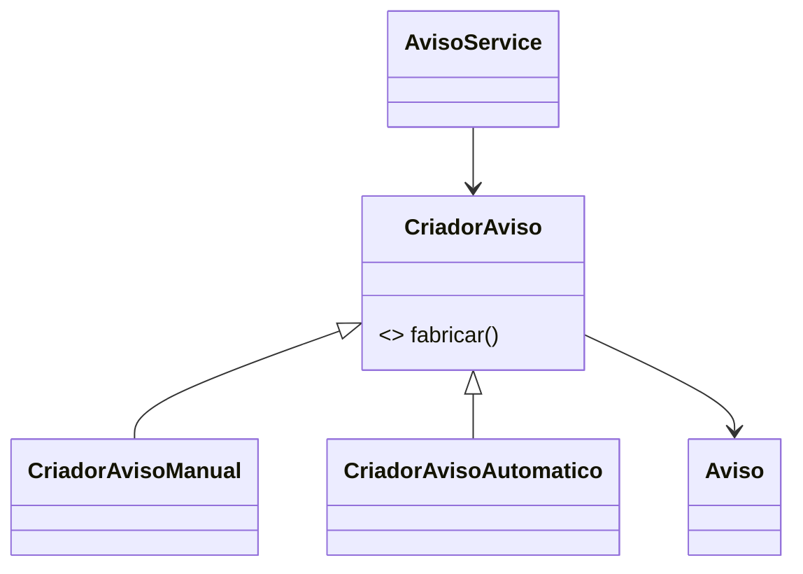
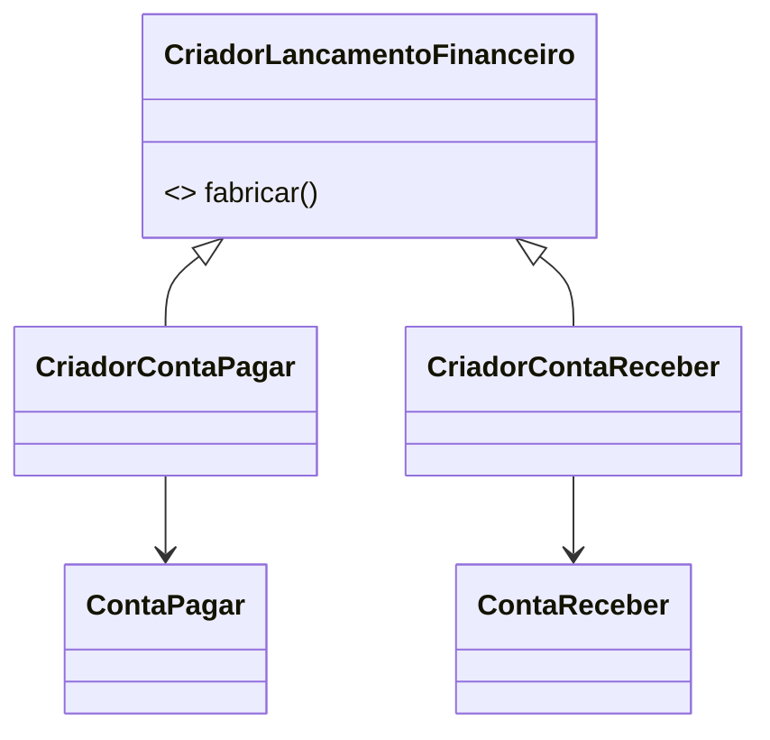
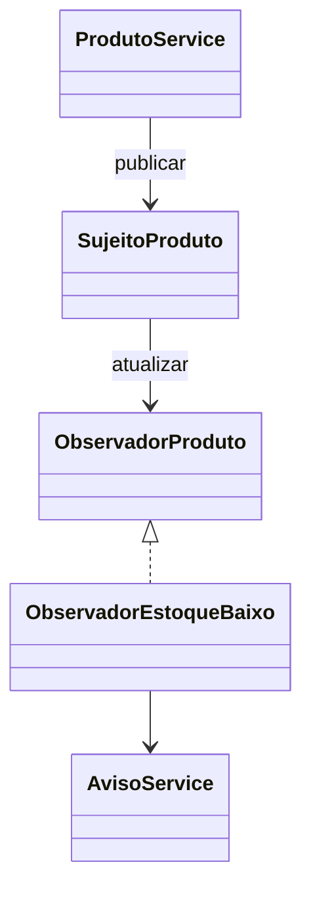
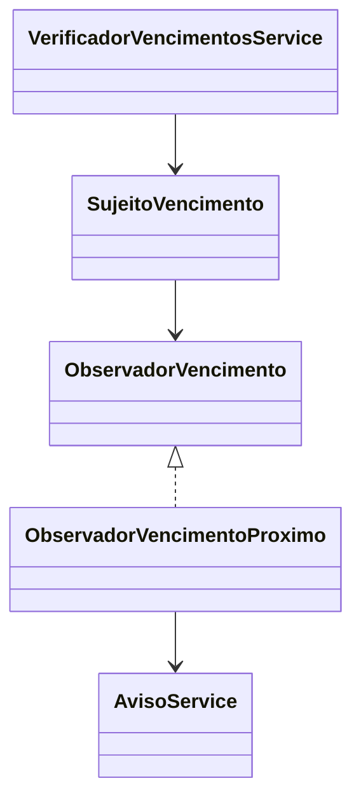

# Padrões de Projeto — Etapa 05

## Visão geral

Foram implementados exatamente três padrões, em dois fluxos reais cada: Strategy (cálculos não persistentes), Factory Method (criação de avisos e lançamentos) e Observer (avisos automáticos). Nenhuma tabela foi criada ou modificada.

## 1. Strategy: encargos de contas a pagar

**Problema e escolha.** Uma conta pode não ter encargo, ter multa percentual única ou juros percentuais por dia. A interface `CalculoEncargoStrategy` permite trocar o algoritmo por polimorfismo, sem condicional no cálculo.

**Classes.** `CalculoEncargoStrategy`, `SemEncargoStrategy`, `MultaPercentualStrategy`, `JurosDiariosStrategy`, `ContextoEncargo` e `ResultadoCalculo`.

`BigDecimal` é usado em todos os valores. Percentuais, dias e valores negativos são rejeitados. A simulação calcula sempre sobre `valorOriginal`, portanto não reaplica encargo, nem salva alterações.

Execute: `GET /api/contas-pagar/{id}/simulacao-encargos?estrategia=JUROS_DIARIOS&percentual=1.5&dias=3`. Estratégias aceitas: `SEM_ENCARGO`, `MULTA_PERCENTUAL`, `JUROS_DIARIOS`.

## 2. Strategy: descontos de contas a receber

**Problema e escolha.** Descontos podem ser inexistentes, percentuais ou valor fixo. `CalculoDescontoStrategy` separa esses cálculos e `ContextoDesconto` seleciona o polimorfismo pelo nome.

**Classes.** `CalculoDescontoStrategy`, `SemDescontoStrategy`, `DescontoPercentualStrategy`, `DescontoValorFixoStrategy`, `ContextoDesconto`.

O desconto é limitado ao valor original, não modifica a entidade. Execute: `GET /api/contas-receber/{id}/simulacao-descontos?estrategia=VALOR_FIXO&parametro=20&dias=0`.

## 3. Factory Method: avisos manuais e automáticos

**Problema e escolha.** Avisos possuem origem distinta, mas terminam persistidos em `Aviso`. `CriadorAviso` concentra o fluxo comum e delega a criação para `CriadorAvisoManual` e `CriadorAvisoAutomatico`.

**Classes.** `DadosAviso`, `CriadorAviso`, `CriadorAvisoManual`, `CriadorAvisoAutomatico`.

O CRUD de aviso usa o criador manual. Os observers usam o automático, que marca `ESTOQUE_BAIXO` ou `VENCIMENTO_PROXIMO` e persiste pelo mesmo `AvisoService`.

## 4. Factory Method: lançamentos financeiros

**Problema e escolha.** O cadastro de contas a pagar e receber precisa criar entidades diferentes sem uma condicional central. `CriadorLancamentoFinanceiro` declara o Factory Method; os criadores concretos retornam um produto `LancamentoFinanceiro` que encapsula a entidade criada.

**Classes.** `LancamentoFinanceiro`, `CriadorLancamentoFinanceiro`, `CriadorContaPagar`, `CriadorContaReceber`.

`ContaPagarService.criar` e `ContaReceberService.criar` utilizam os criadores antes de preencher e persistir os dados dos CRUDs existentes.

## 5. Observer: estoque mínimo

**Problema e escolha.** Produto não deve depender diretamente da lógica de aviso. Após salvar um produto, `ProdutoService` publica `EventoProduto` em `SujeitoProduto`; `ObservadorEstoqueBaixo` é notificado e pede ao `AvisoService` um aviso automático se `quantidadeEstoque <= quantidadeMinima`.

A chave estável `ESTOQUE:{produtoId}` evita duplicar alerta enquanto o produto continuar abaixo do mínimo. Atualize/crie um produto abaixo do mínimo pelo CRUD e consulte `GET /api/avisos`.

## 6. Observer: vencimento próximo

**Problema e escolha.** A passagem do tempo não é um evento de entidade. `POST /api/contas-pagar/verificar-vencimentos` chama `VerificadorVencimentosService`, que busca contas `PENDENTE` ou `VENCIDO` entre hoje e hoje + 3 dias corridos, publica `EventoVencimento` e notifica `ObservadorVencimentoProximo`.

A chave `VENCIMENTO:{contaId}:{vencimento}` evita repetir aviso para o mesmo vencimento. Contas pagas são excluídas da consulta. O aviso automático é persistido e aparece no CRUD de Avisos.

## Testes e estudo

`PadroesTest` cobre os dois conjuntos de Strategy e os dois Factory Methods. Em 08/10/2026, `mvn test` executou 4 testes com sucesso e `mvn package` foi aprovado. O frontend também permanece sem alterações nesta etapa; seu build deve continuar sendo `npm run build`.

Evidências HTTP executadas com MariaDB ativo:

- `GET /api/contas-pagar/6/simulacao-encargos?estrategia=JUROS_DIARIOS&percentual=2&dias=3` retornou original `100.00`, ajuste `6.00` e calculado `106.00`.
- `GET /api/contas-receber/5/simulacao-descontos?estrategia=VALOR_FIXO&parametro=25&dias=0` retornou ajuste `25.00` e calculado `75.00`.
- O produto de teste `id=7`, abaixo do mínimo, gerou a chave `ESTOQUE:7`.
- A conta a pagar de teste `id=6`, com vencimento em 09/10/2026, gerou a chave `VENCIMENTO:6:2026-10-09` ao executar `POST /api/contas-pagar/verificar-vencimentos`.
- Reexecutar a verificação não criou nova chave equivalente; após marcar a conta como `PAGO`, ela deixou de ser elegível.

Os registros de demonstração dos observers foram preservados intencionalmente: os avisos possuem FKs de histórico que impedem exclusão física de suas origens. A conta de teste foi marcada como paga; produto e avisos podem ser consultados no CRUD.

Perguntas para a prova:

1. **Por que Strategy?** Porque o contexto depende de uma interface e escolhe algoritmos intercambiáveis por polimorfismo.
2. **Por que Factory Method não é um `switch`?** Porque o criador abstrato define o fluxo e subclasses decidem qual produto concreto instanciar.
3. **Qual desacoplamento do Observer?** O serviço publica um evento sem conhecer a regra específica de aviso; o observador reage e pode ser trocado/adicionado.
4. **Diferença dos dois Observers?** Estoque é disparado após salvar produto; vencimento é disparado por uma verificação manual de período.
5. **Por que avisos não duplicam?** `chave_evento` é única no banco e também é consultada antes de salvar.
