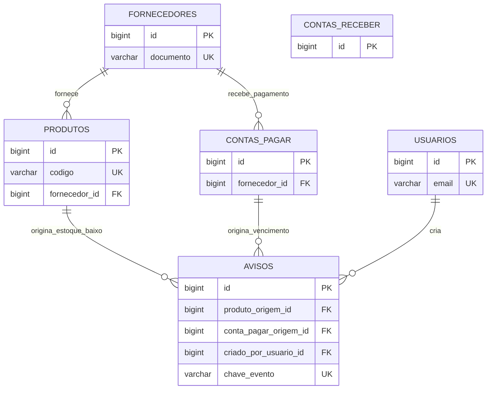

# AMT Solution — Banco de Dados (Etapa 02)

## Banco e compatibilidade

O banco chama-se `amt_solution`. Os scripts usam apenas recursos presentes no MySQL 8+ e no MariaDB 10.4+ normalmente distribuído pelo XAMPP: InnoDB, `utf8mb4`, `BIGINT`, `DECIMAL`, `DATE`, `DATETIME`, `ENUM`, índices e chaves estrangeiras. Não foram usados recursos exclusivos de versões recentes.

O cliente instalado no XAMPP é MariaDB 10.4.32. A tentativa de conexão somente de leitura em `localhost` retornou erro 10061 (servidor não iniciado ou porta não disponível); por isso, os scripts foram revisados estaticamente, mas não foram executados contra uma instância local. Inicie o MySQL pelo painel do XAMPP e execute-os pelo phpMyAdmin.

## Tabelas e campos

| Tabela | Finalidade e campos principais |
| --- | --- |
| `fornecedores` | Cadastro de fornecedor: `id`, `nome`, `documento` (CNPJ/CPF no formulário), contato, telefone, e-mail, `ativo` e auditoria. `documento` é único. |
| `produtos` | Produtos e insumos da mesma tela, distinguidos por `tipo`: `id`, `codigo`/SKU, nome, categoria, unidade, `preco_venda`, quantidades atual e mínima, alérgenos, lote, validade, `ativo` e `fornecedor_id`. `codigo` é único. |
| `contas_pagar` | Despesas: descrição, categoria, fornecedor opcional, vencimento, valor original, situação, pagamento, observação e os campos de encargos. |
| `contas_receber` | Recebíveis: descrição, categoria, cliente, vencimento, valor original, situação, recebimento, observação e os campos de descontos. |
| `usuarios` | Nome, e-mail único, cargo, perfil, `senha_hash` opcional, `ativo` e auditoria. Senhas nunca são persistidas em texto puro; o hash será gerado pelo backend futuramente. |
| `avisos` | Avisos manuais ou automáticos: título, corpo, tipo, prioridade, público, período, situação, chave do evento e referências opcionais à origem e ao criador. |

As datas de criação/atualização em todas as tabelas são `DATETIME`. Valores financeiros são `DECIMAL(10,2)`; estoque usa `DECIMAL(12,3)` para também suportar kg e litros.

## Chaves, relacionamentos e exclusão

- Todas as tabelas possuem `id BIGINT UNSIGNED AUTO_INCREMENT` como chave primária.
- Um fornecedor possui vários produtos e várias contas a pagar. Ao excluir um fornecedor, as referências opcionais recebem `NULL`; nenhum lançamento financeiro é excluído.
- Um produto ou uma conta a pagar pode originar vários avisos. Essas exclusões são bloqueadas enquanto houver aviso relacionado, preservando o histórico. O fluxo normal da tela é desativar produto, não apagá-lo.
- Um usuário pode criar vários avisos. Ao excluir o criador, o aviso é preservado e a referência fica `NULL`.
- Não há `ON DELETE CASCADE` em dados financeiros ou históricos.



Não foi criada tabela auxiliar: fornecedor e contas já atendem às relações necessárias; os tipos de lançamento e aviso são atributos, pois Factory Method e Strategy serão classes Java, não estruturas de banco. A situação de leitura por destinatário não foi modelada porque os avisos atuais são comunicados por público, e não mensagens individuais. Uma futura tela de leitura individual justificaria uma tabela `aviso_leituras`.

## Relação com as telas e padrões

| Tela CRUD | Persistência |
| --- | --- |
| Produtos | `produtos`; inclui produtos e insumos já presentes na mesma página, com fornecedor opcional. |
| Fornecedores | `fornecedores`. |
| Contas a Pagar | `contas_pagar` e fornecedor opcional. Modal de pagamento usa data, valor e forma de pagamento. |
| Contas a Receber | `contas_receber`. Modal de recebimento usa data, valor e forma de recebimento. |
| Usuários | `usuarios`; o campo de senha é reservado apenas como hash para etapa futura. |
| Avisos | `avisos`; inclui avisos manuais e automáticos. |

Para Strategy, `contas_pagar` guarda estratégia, percentuais e `valor_encargos`; `contas_receber` guarda estratégia, percentual e `valor_desconto`. Para Factory Method, os campos `tipo` de aviso e os tipos implícitos das duas tabelas financeiras permitem identificar o produto criado. Para Observer, a consulta de estoque compara `quantidade_estoque` com `quantidade_minima`; a de vencimento consulta contas pendentes até sete dias. Um job agendado no backend executará essa segunda consulta diariamente. `avisos.chave_evento` é única e evita criar novamente o mesmo aviso automático para uma mesma origem/evento.

## Importação no phpMyAdmin

1. Inicie MySQL/MariaDB pelo painel do XAMPP e abra o phpMyAdmin.
2. Abra a aba **Importar** e envie, nesta ordem: `database/01_schema.sql`, `database/02_seed.sql` e `database/03_testes.sql`.
3. Escolha formato SQL e clique em **Importar**. O primeiro script cria `amt_solution` sem remover qualquer banco existente.
4. Se o phpMyAdmin já estiver com outro banco selecionado, os comandos `USE amt_solution` dos dois últimos scripts garantem o destino correto.

Consultas simples de confirmação:

```sql
USE amt_solution;
SHOW TABLES;
SELECT codigo, nome, quantidade_estoque, quantidade_minima FROM produtos;
SELECT descricao, vencimento, situacao FROM contas_pagar;
SELECT titulo, tipo, situacao FROM avisos;
```

O arquivo `database/03_testes.sql` também possui consultas de JOIN, alertas e um CRUD de teste protegido por `START TRANSACTION` e `ROLLBACK`.
