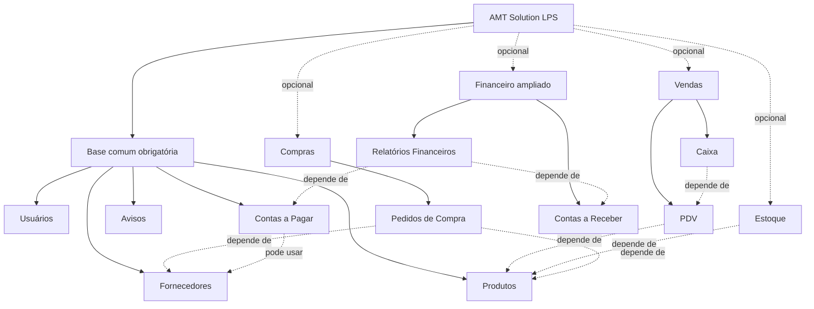

# Variabilidade e Linha de Produto de Software — AMT Solution

## 1. Ideia da Linha de Produto de Software

Uma Linha de Produto de Software (LPS) é uma forma de reutilizar uma mesma base para criar produtos parecidos, porém configurados para necessidades diferentes. Em vez de criar um sistema independente para uma loja de doces e outro para um prestador de serviços, o AMT Solution teria um núcleo comum e módulos selecionáveis.

**Variabilidade** responde: “quais módulos pertencem a esta configuração do produto?”. Ela é diferente de **permissão**, que responde: “o que este usuário pode fazer dentro de um módulo já presente?”. Por exemplo, uma configuração pode não incluir PDV; se incluir, um operador de caixa pode ou não ter permissão para usá-lo.

Este é um planejamento acadêmico. Hoje, os CRUDs reais são Produtos, Fornecedores, Contas a Pagar, Contas a Receber, Usuários e Avisos. PDV, Caixa, Estoque, Pedidos, Visão Financeira, Relatórios e Permissões são rotas/telas existentes no protótipo React, mas não possuem backend integrado nesta versão.

## 2. Objetivo no AMT Solution

A família planejada atende pequenos estabelecimentos. Todos reutilizariam a mesma arquitetura React, Spring Boot, MariaDB, entidades, serviços e padrões de projeto. A configuração escolheria os módulos adequados ao negócio sem duplicar código ou banco para cada variante.

## 3. Características do modelo

### Base obrigatória da família

| Característica | Papel | Estado atual |
| --- | --- | --- |
| Aplicação e navegação base | React, API Spring Boot e MariaDB | Implementada |
| Usuários | Identificação de usuários e perfis | CRUD integrado |
| Produtos | Catálogo de produtos/insumos | CRUD integrado |
| Fornecedores | Relação de compra e fornecimento | CRUD integrado |
| Financeiro básico | Contas a Pagar e regras de encargos | CRUD integrado |
| Avisos | Comunicados manuais e automáticos | CRUD integrado |

“Obrigatória” descreve a base da LPS planejada; não significa que toda tela esteja necessariamente ativa para todo usuário.

### Características opcionais planejadas

| Grupo | Módulos | Estado atual |
| --- | --- | --- |
| Vendas | PDV, Caixa | Protótipo React; sem backend real |
| Estoque | Estoque e alertas de estoque mínimo | Tela de estoque é protótipo; alerta mínimo é real no backend de Produtos/Avisos |
| Compras | Pedidos de Compra | Protótipo React |
| Financeiro ampliado | Contas a Receber, Visão Financeira, Relatórios Financeiros | Contas a Receber é CRUD integrado; demais são protótipo |
| Administração | Permissões e Módulos | Protótipo React; não é controle de acesso implementado |

## 4. Feature Model



Legenda: setas contínuas representam composição obrigatória; linhas tracejadas com “opcional” representam seleção de variante; linhas tracejadas com “depende de” representam uma regra de dependência. O diagrama é de planejamento, não uma descrição de ativação já implementada.

## 5. Regras objetivas de variabilidade

1. PDV só pode ser habilitado se Produtos estiver habilitado.
2. Caixa requer PDV; logo, também requer Produtos indiretamente.
3. Estoque requer Produtos.
4. Pedidos de Compra requer Produtos e Fornecedores.
5. Relatórios financeiros requerem Contas a Pagar e Contas a Receber; a tela é planejada, não integrada hoje.
6. Contas a Pagar pode operar sem fornecedor, pois o relacionamento atual é opcional; quando Fornecedores estiver ativo, ele pode ser selecionado.
7. Desativar um módulo não apaga seus dados: a configuração apenas deixa de expor e autorizar a funcionalidade.
8. Cada configuração é independente das permissões de usuários. Primeiro define-se quais módulos existem no produto; depois definem-se permissões dentro deles.

### Configuração inválida

`{ PDV: ativo, Produtos: inativo }` é inválida. O PDV depende de um catálogo de produtos, portanto não haveria itens para venda. A configuração deve ser rejeitada antes de ser aplicada.

## 6. Configuração A — Loja de doces

Uma loja de doces vende itens alimentícios, compra insumos e controla vendas diárias.

| Módulo | Estado | Justificativa |
| --- | --- | --- |
| Produtos e Fornecedores | Ativo | Cadastro de doces, ingredientes e fornecedores |
| Estoque | Ativo | Controla ingredientes e alerta mínimo |
| PDV e Caixa | Ativo | Registra vendas de balcão e fechamento diário |
| Pedidos de Compra | Ativo | Planeja reposição de insumos |
| Contas a Pagar | Ativo | Despesas, fornecedores e vencimentos |
| Contas a Receber | Ativo | Encomendas, eventos e clientes corporativos |
| Avisos e Usuários | Ativo | Comunicação, alertas e operação por equipe |
| Relatórios Financeiros | Opcional planejado | Útil para acompanhamento gerencial |

Essa variante reutiliza todos os seis CRUDs reais. PDV, Caixa, Estoque, Pedidos e Relatórios dependeriam de implementação futura para serem habilitados de verdade.

## 7. Configuração B — Prestador de serviços

Um prestador de serviços não vende mercadorias por estoque, mas precisa controlar despesas, recebimentos e equipe.

| Módulo | Estado | Justificativa |
| --- | --- | --- |
| Usuários | Ativo | Organiza equipe e perfis |
| Contas a Pagar | Ativo | Despesas operacionais e vencimentos |
| Contas a Receber | Ativo | Cobrança de serviços prestados |
| Avisos | Ativo | Comunicados e alertas financeiros |
| Relatórios Financeiros | Ativo planejado | Acompanha receitas e despesas |
| Produtos e Fornecedores | Inativo na interface | Não são foco do serviço; poderão permanecer no núcleo técnico se houver despesas vinculadas |
| Estoque, PDV, Caixa, Pedidos de Compra | Inativos | Não há venda de mercadoria nem compra de insumos recorrente |

As duas variantes reutilizam Usuários, Financeiro e Avisos. A loja de doces acrescenta vendas, estoque e compras; o prestador prioriza o financeiro.

## 8. Como o reuso acontece

O reuso ocorre em três níveis:

1. **Arquitetura:** uma base React/Spring/MariaDB atende as variantes.
2. **Funcionalidades:** CRUDs, entidades e serviços existentes são aproveitados por mais de um tipo de negócio.
3. **Regras reutilizáveis:** Strategy para encargos/descontos, Factory Method para avisos/lançamentos e Observer para alertas continuam disponíveis quando os módulos relacionados forem selecionados.

Isso reduz duplicação, testes repetidos e custo de manter dois sistemas separados. A variabilidade não elimina a necessidade de validar combinações de módulos.

## 9. Proposta de implementação futura

Não há mecanismo de módulos ativo nesta versão e nenhum arquivo de código ou banco foi alterado nesta etapa. Se o projeto fosse ampliado, uma solução simples seria:

```text
configuracaoDoEstabelecimento = {
  produtos: true,
  fornecedores: true,
  pdv: true,
  caixa: true,
  estoque: true,
  contasReceber: true
}

validarDependencias(configuracaoDoEstabelecimento)
frontend: renderizar menu somente para módulos ativos
backend: recusar rota de módulo inativo para aquela configuração
```

Em produção, a configuração poderia ser persistida por estabelecimento em tabelas próprias, carregada após a identificação do estabelecimento e validada tanto no frontend quanto no backend. Esse mecanismo exigiria modelagem, endpoints, migração e segurança próprios — por isso não foi implementado agora.

## 10. Benefícios e limitações

**Benefícios:** maior reuso, variantes mais adequadas ao negócio, menor duplicação e evolução centralizada da base comum.

**Limitações atuais:** a seleção dinâmica não existe; módulos mockados não possuem backend; não há autenticação completa nem permissões aplicadas; e o modelo deve ser revisto caso surjam novos tipos de estabelecimento ou regras fiscais.

## 11. Roteiro para apresentação ao professor

1. Explique que a LPS é uma família de produtos, não dois sistemas copiados.
2. Mostre a base comum real: os seis CRUDs e os padrões de projeto.
3. Apresente o Feature Model e a legenda.
4. Mostre a tabela da loja de doces e destaque PDV, Caixa, Estoque e Compras.
5. Mostre a tabela do prestador de serviços e destaque o foco financeiro.
6. Compare o que é reutilizado nas duas variantes.
7. Mostre a configuração inválida PDV sem Produtos e explique a dependência.
8. Finalize esclarecendo: esta etapa planeja a variabilidade; ela não ativa módulos dinamicamente na aplicação atual.

## 12. Perguntas e respostas para autoria

1. **O que é variabilidade?** É a capacidade planejada de selecionar características diferentes da mesma família de software.
2. **O que é uma LPS?** Uma base comum mais variabilidades para gerar produtos relacionados.
3. **Qual a diferença entre variabilidade e permissão?** Variabilidade seleciona módulos do produto; permissão limita ações de um usuário em módulos já selecionados.
4. **Por que PDV depende de Produtos?** Porque o PDV precisa de itens cadastrados para vender.
5. **Por que Caixa depende de PDV?** Porque seu fechamento usa os movimentos de venda registrados no PDV.
6. **A tela de Relatórios está implementada no backend?** Não. Existe como protótipo React e é apenas uma característica planejada.
7. **Como evitaria remover dados ao desativar módulo?** Desabilitaria menu e rotas autorizadas, preservando as tabelas e históricos.
8. **Como seria implementado futuramente?** Com configuração por estabelecimento, validação de dependências, menu condicionado e bloqueio correspondente no backend.
